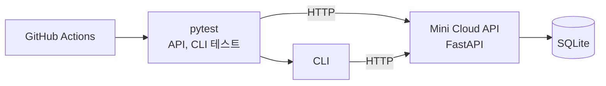
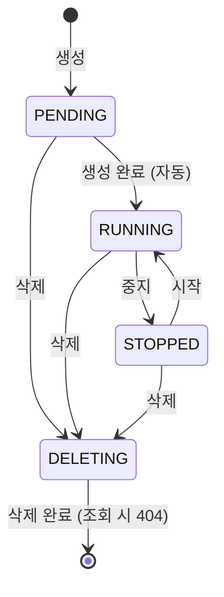
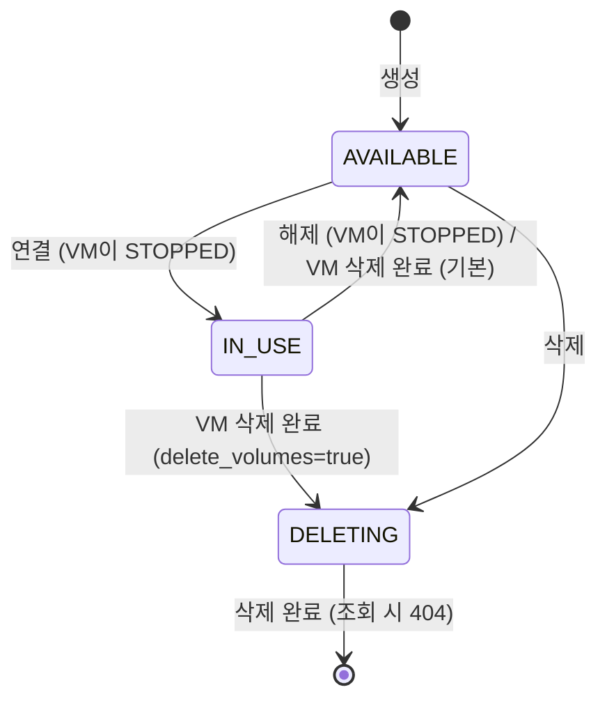

# Mini Cloud QA

가상 서버(VM)와 볼륨을 관리하는 간단한 IaaS 형태의 API를 구현하고, 명세 검토부터 테스트 설계, 테스트 자동화, CI 구성, 발견 사항 기록까지 수행한 프로젝트입니다.
실제 VM이나 스토리지는 만들지 않고, 리소스의 상태 변화와 처리 시간만 모사합니다.

## 개요



| 구분 | 내용 |
|---|---|
| 검증 대상 | VM 생성·시작·중지·삭제, 볼륨 생성·연결·해제·삭제 API와 CLI |
| 검증 방식 | 서비스 코드를 직접 호출하지 않고 HTTP 요청으로만 확인하는 시스템 테스트 |
| 기술 스택 | Python 3.12, FastAPI, SQLAlchemy, SQLite, Typer, pytest, GitHub Actions |

## 수행한 작업

| 단계 | 내용 |
|---|---|
| 명세 작성·검토 | VM·볼륨의 상태, 입력값 규칙을 정의하고, 모호한 부분 13건을 설계 결정으로 확정 |
| 테스트 설계 | 상태 전이, 경계값 분석, 동등 분할, 결정 테이블 기법으로 케이스 설계 |
| 수동 테스트 | API 문서 화면(`/docs`)과 CLI로 설계 표를 따라 직접 확인, 발견 사항 기록 |
| 테스트 자동화 | 설계 표의 각 행을 pytest 테스트로 작성 (API·CLI 132개) |
| CI 구성 | PR과 `main` 푸시마다 서버를 띄워 전체 테스트 실행 |

---

## 서비스 명세

### VM 상태



### VM 상태 전이표

각 칸이 상태 전이 테스트 케이스 하나입니다.

| 현재 상태 | 시작 | 중지 | 삭제 |
|---|---|---|---|
| `PENDING` | 409 | 409 | 202 → `DELETING` |
| `RUNNING` | 200 (`RUNNING` 유지) | 200 → `STOPPED` | 202 → `DELETING` |
| `STOPPED` | 200 → `RUNNING` | 200 (`STOPPED` 유지) | 202 → `DELETING` |
| `DELETING` | 409 | 409 | 202 (`DELETING` 유지) |
| (삭제 완료) | 404 | 404 | 404 |

- 409: 리소스는 있지만 현재 상태에서 허용되지 않는 동작 / 404: 리소스 없음 / 202: 요청을 받아 처리 중
- 시작·중지·삭제 응답에는 요청 직전 상태 `previous_status`가 함께 담깁니다.

### 볼륨 상태



- 볼륨 하나는 VM 하나에만 연결되고, 연결·해제는 VM이 `STOPPED`일 때만 가능합니다.
- 사용 중(`IN_USE`)인 볼륨은 해제하기 전에 삭제할 수 없습니다 (409).
- VM이 삭제되는 동안(`DELETING`) 볼륨은 `IN_USE`로 남고, VM 삭제가 끝나는 시점에 해제되거나 함께 삭제됩니다.

### 볼륨 상태 전이표

연결·해제는 대상 VM이 `STOPPED`라고 가정한 결과입니다. 단, 이미 연결된 같은 VM에 다시 연결하는 경우는 VM 상태와 관계없이 200입니다 (설계 결정 12).

| 볼륨 상태 | 연결 (같은 VM) | 연결 (다른 VM) | 해제 | 삭제 |
|---|---|---|---|---|
| `AVAILABLE` | 200 → `IN_USE` | 200 → `IN_USE` | 200 (이미 해제됨) | 202 → `DELETING` |
| `IN_USE` | 200 (이미 연결됨) | 409 | 200 → `AVAILABLE` | 409 |
| `DELETING` | 409 | 409 | 409 | 202 (`DELETING` 유지) |
| (삭제 완료) | 404 | 404 | 404 | 404 |

### 볼륨이 연결된 VM의 삭제 (결정 테이블)

| 볼륨 연결됨 | `delete_volumes` | VM 결과 | 볼륨 결과 |
|---|---|---|---|
| 아니오 | `false` / `true` | `DELETING` | 해당 없음 |
| 예 | `false` (기본값) | `DELETING` | 자동 해제 → `AVAILABLE` |
| 예 | `true` | `DELETING` | 함께 `DELETING` |

### 입력값 규칙

| 항목 | 규칙 |
|---|---|
| 이름 | 1~63자, 영문 소문자·숫자·하이픈, 하이픈으로 시작·종료 불가 |
| CPU | 1, 2, 4, 8 중 하나 |
| 메모리(GB) | 1~64 정수 |
| 볼륨 크기(GB) | 1~1024 정수 |

숫자 항목은 JSON 정수만 허용합니다. `"4"`, `4.0`, `true`는 변환하지 않고 422로 거부합니다.

---

## 설계 원칙과 설계 결정

명세가 정하지 않은 상황은 다음 원칙으로 판단했습니다.

1. 삭제 중인 리소스는 삭제 재요청(202)을 제외한 모든 동작을 거부한다 (409).
2. 요청한 결과가 이미 이루어져 있으면 성공을 반환한다. (재시도해도 안전하도록)
3. 요청한 결과를 이룰 수 없으면 409를 반환한다.
4. 데이터 손실 가능성이 있는 동작은 기본적으로 막고, 명시적으로 요청할 때만 허용한다.

| # | 상황 | 결정 | 근거 |
|---|---|---|---|
| 1 | 생성 중(`PENDING`) VM 삭제 | 허용 | 생성이 멈추면 정리할 방법이 없음 |
| 2 | 초기 `TERMINATED` 상태가 "삭제 중"과 "삭제 완료"를 함께 의미 | `DELETING` 상태 추가 | 409와 404가 섞이는 모순 해소 |
| 3 | 삭제 중인 VM 재삭제 | 202 | 재시도 안전 (멱등) |
| 4 | `"4"`, `4.0`, `true` 같은 숫자 입력 | 422 | `true`가 1로 바뀌는 등의 의도치 않은 생성 방지 |
| 5 | 숫자로만 된 이름, 연속 하이픈 | 허용 | 기존 규칙을 단순하게 유지 |
| 6 | 볼륨 연결·해제 가능한 VM 상태 | `STOPPED`만 | 실행 중 디스크 작업으로 인한 데이터 손상 방지 |
| 7 | 사용 중인 볼륨 삭제 | 409 | 명시적인 해제 단계를 거치도록 |
| 8 | 이미 연결된 볼륨 재연결 | 같은 VM 200, 다른 VM 409 | 원칙 2, 3 |
| 9 | 볼륨이 연결된 VM 삭제 | 기본 자동 해제, 옵션 시 함께 삭제 | 원칙 4 |
| 10 | 실행 중인 VM 시작, 중지된 VM 중지 | 409 → 200으로 변경 | 원칙 2와의 충돌 해소 (F-002) |
| 11 | 응답만으로 실제 변경 여부를 알 수 없음 | `previous_status` 추가 | 멱등성을 유지하면서 변경 여부 전달 (F-003) |
| 12 | 볼륨 API의 같은 상황 | 10, 11을 동일하게 적용 | VM과 볼륨의 응답 해석 방식 통일 |
| 13 | 삭제 중인 VM에 다른 `delete_volumes` 값으로 재요청 | 409 | 성공 응답을 주며 옵션을 무시하던 문제 해결 (F-005) |

선택지 비교와 상세 근거: [docs/design-decisions.md](docs/design-decisions.md)

---

## 테스트 설계와 자동화

| 테스트 파일 | 기법 | 대상 | 수 |
|---|---|---|---|
| `test_vm_state_transition.py` | 상태 전이 | VM 상태 전이표, `previous_status`, 자동 상태 전환 | 23 |
| `test_vm_validation.py` | 경계값 분석, 동등 분할 | 이름 길이·형식, 메모리, CPU, 잘못된 타입 | 42 |
| `test_volume.py` | 상태 전이, 경계값 분석 | 볼륨 상태 전이표, 볼륨 크기 | 40 |
| `test_vm_delete_with_volumes.py` | 결정 테이블 | 볼륨이 연결된 VM 삭제, 옵션 조합 8가지, 회귀 | 17 |
| `test_cli.py` | - | CLI 출력, stdout·stderr 구분, 종료 코드 0·1·2 | 10 |

설계 표의 행을 그대로 `pytest.mark.parametrize`의 데이터로 옮겨, 표와 테스트를 한 줄씩 대조할 수 있게 했습니다.

```python
# 상태 전이표: (현재 상태, 동작, 기대 응답 코드, 기대 이후 상태)
TRANSITIONS = [
    ("PENDING", "start", 409, "PENDING"),
    ("PENDING", "delete", 202, "DELETING"),  # 설계 결정 1
    ("RUNNING", "start", 200, "RUNNING"),    # 설계 결정 10
    ("DELETING", "delete", 202, "DELETING"), # 설계 결정 3
    # ... 15개 행
]
```

**CI** ([`ci.yml`](.github/workflows/ci.yml)): PR과 `main` 푸시마다 Ubuntu 환경에서 의존성 설치 → API 서버 실행(전환 시간 1초) → `/health` 대기 → `pytest -v` → 실패 시 서버 로그 출력, 테스트 결과(JUnit XML)와 서버 로그를 artifact로 보관합니다.

경계값·동등 분할 표 전체: [docs/test-design.md](docs/test-design.md)

---

## 결과

### 테스트 결과

| 항목 | 결과 |
|---|---|
| 자동 테스트 (GitHub Actions) | 132개 중 131 통과, 1 `XFAIL` (F-004), 약 2분 |
| PR 동작 확인 | 설계 결정 10에 해당하는 코드를 주석 처리한 PR에서 CI가 `2 failed`로 실패하는 것을 확인하고, 병합하지 않고 닫음 |

### 발견 사항

| ID | 내용 | 종류 | 상태 |
|---|---|---|---|
| F-001 | 이름 형식 오류 메시지에 정규식이 그대로 노출됨 | 개선 제안 | 열림 |
| F-002 | 같은 상태로의 시작·중지 결과가 설계 원칙 2와 충돌 | 명세 모호 | 해결 (설계 결정 10) |
| F-003 | 상태 변경 응답만으로 실제 변경 여부를 알 수 없음 | 개선 제안 | 해결 (설계 결정 11) |
| F-004 | SQLite에서 삭제된 id가 재사용되어, 삭제 재시도가 다른 VM을 삭제할 수 있음 | 결함 | 열림 |
| F-005 | 삭제 중인 VM에 다른 옵션으로 재요청하면 성공 응답과 함께 옵션이 무시됨 | 명세 모호 | 해결 (설계 결정 13) |
| F-006 | 코드 적용 누락으로 VM 삭제 후 볼륨이 정리되지 않고, 재삭제 시 500 | 결함 | 해결 |
| F-007 | VM 조회 결과에 연결된 볼륨이 보이지 않음 | 개선 제안 | 열림 |

**F-004 (결함, 열림)**
- 증상: VM 1번을 삭제한 뒤 새 VM을 만들면 다시 1번을 받습니다. 이때 처음 VM에 대한 삭제 요청이 재시도되면 새 VM이 삭제됩니다.
- 원인: SQLite는 `AUTOINCREMENT`가 없으면 "현재 가장 큰 id + 1"을 새 id로 사용합니다.
- 조치: 운영 DB를 PostgreSQL로 한정하고, SQLite는 개발용으로만 사용합니다. 관련 테스트는 `XFAIL`로 표시했습니다. PostgreSQL 환경 검증은 아직 진행하지 않았습니다.

**F-006 (결함, 해결)**
- 증상: 수동 테스트에서는 VM 삭제 후 볼륨이 `IN_USE`로 남았고, 자동 테스트에서는 삭제 재요청이 500으로 실패했습니다.
- 원인: 여러 파일을 함께 바꾸는 변경에서 두 곳이 반영되지 않았습니다. `models.py`의 `delete_volumes` 칸(500의 원인)과 `lifecycle.py`의 볼륨 정리 코드(볼륨이 남는 원인)입니다. 처음에는 한 곳만 원인으로 판단했으나, 수정 후 회귀 테스트에서 실패가 남아 두 번째 원인을 확인했습니다.
- 조치: 두 곳을 수정하고 회귀 테스트를 추가했습니다. CI 전체 통과로 확인했습니다.

재현 절차, 기대·실제 결과, 판단 근거: [docs/findings.md](docs/findings.md)

---

## 결론과 남은 과제

- 상태 전이표, 입력값 규칙, 결정 테이블에 정의한 동작은 자동 테스트로 확인했습니다.
- F-004는 SQLite 환경에서만 생기는 문제로, PostgreSQL 사용을 전제로 두었으나 해당 환경에서의 검증은 남아 있습니다.
- 같은 이름의 VM 생성, 정의되지 않은 입력 항목, 같은 리소스에 대한 동시 요청은 명세가 확정되지 않아 테스트하지 않았습니다.

| 남은 과제 | 관련 |
|---|---|
| Docker Compose로 PostgreSQL 환경을 구성해 전체 테스트 재실행 | F-004 |
| 미확정 명세 3건 결정 후 테스트 추가 | 동시 요청 등 |
| 개선 제안 반영 여부 결정 | F-001, F-007 |

---

## 실행 방법

```bash
pip install -e ".[dev]"

# 터미널 1: 테스트용 설정으로 서버 실행
PROVISION_SECONDS=1 DELETE_SECONDS=1 python -m uvicorn service.main:app

# 터미널 2: 전체 테스트
pytest -v
```

가상환경 구성, CLI 사용법: [docs/how-to-run.md](docs/how-to-run.md)

## 레포 구조

```
mini-cloud-qa/
├── service/                    # API, CLI, 자동 상태 전환
├── tests/
│   ├── api/                    # API 테스트
│   └── cli/                    # CLI 테스트
├── docs/                       # 명세, 설계 결정, 테스트 설계, 발견 사항 상세
├── .github/workflows/ci.yml    # CI
└── pyproject.toml
```
