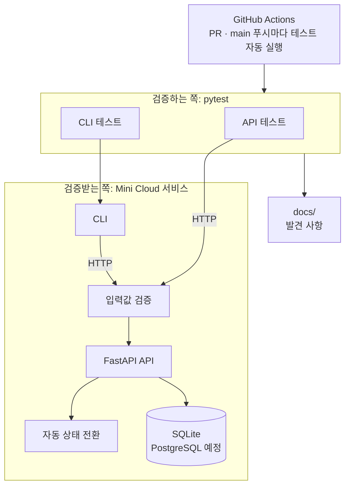
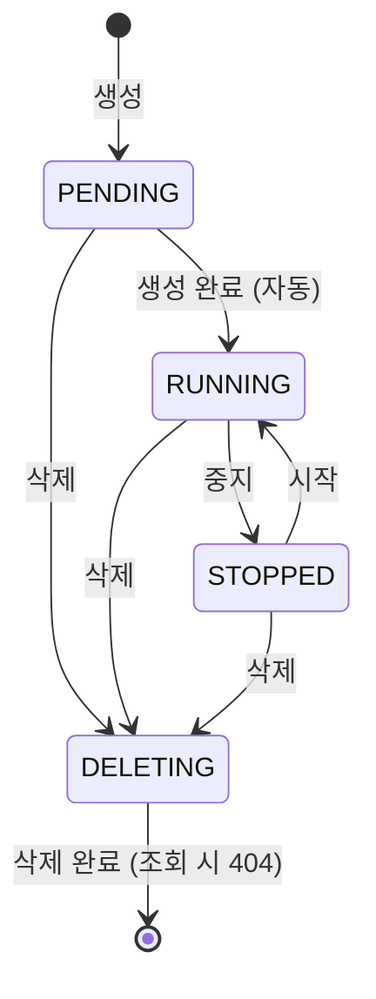

# Mini Cloud QA

가상 서버(VM)와 볼륨을 관리하는 간단한 IaaS 형태의 API를 구현하고, 명세 검토, 테스트 설계, 테스트 자동화, CI 구성, 발견 사항 기록을 수행한 프로젝트입니다.
실제 VM이나 스토리지는 만들지 않고, 리소스의 상태 변화와 처리 시간만 모사합니다.

> 진행 상황: 테스트 설계, 구현, 자동화, CI 구성까지 진행했습니다. PostgreSQL 환경(Docker Compose)에서의 검증은 아직 진행하지 않았습니다.

## 한눈에 보기

| 항목 | 내용 |
|---|---|
| 테스트 기법 | 상태 전이, 경계값 분석, 동등 분할, 결정 테이블 |
| 자동화 테스트 | API·CLI 시스템 테스트 132개 (131 통과, 1 알려진 결함으로 `XFAIL`) |
| CI | GitHub Actions에서 PR과 `main` 푸시마다 전체 테스트 실행 (약 2분) |
| 설계 결정 | 13건 |
| 발견 사항 | 7건: 결함 2, 명세 모호 2, 개선 제안 3 ([docs/findings.md](docs/findings.md)) |

---

## 수행 내용

- 명세를 작성하고, 검토와 구현 과정에서 확인된 모호한 부분을 설계 결정 13건으로 정리했습니다.
- 상태 전이, 경계값 분석, 동등 분할, 결정 테이블 기법으로 테스트 케이스를 설계했습니다.
- 설계한 케이스를 pytest로 옮겨 API·CLI 테스트 132개를 작성했습니다.
- GitHub Actions에서 PR과 `main` 푸시 시 전체 테스트를 실행하도록 구성했습니다.
- 수동·자동 테스트 중 확인된 사항 7건을 재현 절차, 기대 결과, 실제 결과와 함께 기록했습니다.
- AI의 도움을 받아 작성한 코드와 테스트를 명세 및 실행 결과와 대조해 검토했습니다.

## 아키텍처



- 테스트는 서비스 코드를 import하지 않고 **HTTP로만** 검증하는 시스템 테스트입니다. 서버 주소(`MINICLOUD_API_URL`)만 바꾸면 다른 환경을 대상으로 그대로 실행할 수 있습니다.
- 실제 VM을 만들지 않고, 생성·삭제에 걸리는 시간을 모사해 API의 상태 동작을 검증합니다. 실제 환경이라면 이 자리에 하이퍼바이저 연동이 들어갑니다.

### 환경 구분

| 환경 | 역할 |
|---|---|
| 로컬 (SQLite) | 개발 환경. 서비스를 만들고 `/docs`·CLI로 수동 확인, pytest 실행 |
| GitHub Actions (SQLite) | 검증 환경. PR과 `main` 푸시마다 깨끗한 환경에 서버를 새로 띄워 전체 테스트를 실행 |
| Docker Compose (PostgreSQL) | 예정. 운영 환경과 같은 DB로 검증 (F-004 확인) |

### 기술 스택

- **서비스:** Python 3.12, FastAPI, SQLAlchemy, SQLite (PostgreSQL 예정)
- **CLI:** Typer, httpx
- **테스트:** pytest, httpx
- **CI:** GitHub Actions

---

## 서비스 명세

### VM 상태



| 상태 | 의미 |
|---|---|
| `PENDING` | 생성 중 |
| `RUNNING` | 실행 중 |
| `STOPPED` | 중지됨 |
| `DELETING` | 삭제 진행 중 |
| (사라짐) | 삭제 완료. 더 이상 조회되지 않음 |

### 상태 전이표

현재 상태에서 각 동작을 요청했을 때의 기대 결과입니다. 이 표의 각 칸이 상태 전이 테스트 케이스가 됩니다.

| 현재 상태 | 시작 | 중지 | 삭제 |
|---|---|---|---|
| `PENDING` | 409 | 409 | → `DELETING` |
| `RUNNING` | 200 (`RUNNING` 유지) | → `STOPPED` | → `DELETING` |
| `STOPPED` | → `RUNNING` | 200 (`STOPPED` 유지) | → `DELETING` |
| `DELETING` | 409 | 409 | 202 (`DELETING` 유지) |
| (사라짐) | 404 | 404 | 404 |

- **409 Conflict:** VM은 존재하지만 현재 상태에서 허용되지 않는 동작
- **404 Not Found:** VM이 존재하지 않음
- **202 Accepted:** 요청을 받아들였고 작업이 진행 중
- **200 (상태 유지):** 요청한 상태가 이미 이루어져 있어 아무것도 바꾸지 않고 현재 상태를 반환 (설계 원칙 2, 설계 결정 10)

시작·중지·삭제 응답에는 요청 직전 상태인 `previous_status`가 함께 담깁니다 (설계 결정 11). `previous_status`와 `status`가 같으면 원래 그 상태였다는 뜻입니다.

```json
{"id": 1, "name": "web-1", "cpu": 2, "memory_gb": 4, "status": "RUNNING", "previous_status": "RUNNING"}
```

### 입력값 규칙

| 항목 | 규칙 |
|---|---|
| 이름 | 1~63자, 영문 소문자·숫자·하이픈만 허용, 하이픈으로 시작하거나 끝날 수 없음 |
| CPU | 1, 2, 4, 8 중 하나 |
| 메모리(GB) | 1~64 사이의 정수 |
| 볼륨 크기(GB) | 1~1024 사이의 정수 |

- 숫자 항목은 **JSON 정수 타입만** 허용합니다. 문자열(`"4"`), 소수 형태(`4.0`), 참·거짓(`true`)은 자동 변환하지 않고 거부합니다.
- 입력값이 규칙에 맞지 않으면 **422 Unprocessable Entity**를 반환합니다. (상태 때문에 거부되는 409와 구분)

### 볼륨

볼륨은 VM에 연결하는 추가 디스크입니다.

| 상태 | 의미 |
|---|---|
| `AVAILABLE` | 어떤 VM에도 연결되지 않음 |
| `IN_USE` | VM에 연결됨 |
| `DELETING` | 삭제 진행 중 |
| (사라짐) | 삭제 완료. 더 이상 조회되지 않음 |

- 볼륨 하나는 VM 하나에만 연결할 수 있습니다.
- VM 하나에는 여러 볼륨을 연결할 수 있습니다.
- 연결과 해제는 VM이 `STOPPED` 상태일 때만 가능합니다. 그 외 상태의 VM이면 409를 반환합니다.

### 볼륨 상태 전이표

연결·해제는 대상 VM이 `STOPPED` 상태라고 가정한 결과입니다. 단, `IN_USE` 볼륨을 이미 연결된 같은 VM에 다시 연결하는 경우는 VM 상태와 상관없이 200입니다 (설계 결정 12).
연결·해제·삭제 응답에도 VM과 같은 방식으로 `previous_status`가 담깁니다 (설계 결정 12).

| 볼륨 상태 | 연결 (같은 VM) | 연결 (다른 VM) | 해제 | 삭제 |
|---|---|---|---|---|
| `AVAILABLE` | → `IN_USE` | → `IN_USE` | 200 (이미 해제됨) | → `DELETING` |
| `IN_USE` | 200 (이미 연결됨) | 409 | → `AVAILABLE` | 409 |
| `DELETING` | 409 | 409 | 409 | 202 (`DELETING` 유지) |
| (사라짐) | 404 | 404 | 404 | 404 |

### 볼륨이 연결된 VM의 삭제 (결정 테이블)

VM 삭제 요청에 `delete_volumes` 옵션을 줄 수 있습니다. 기본값은 `false`입니다.

| 볼륨 연결됨 | `delete_volumes` | VM 결과 | 볼륨 결과 |
|---|---|---|---|
| 아니오 | `false` | `DELETING` | 해당 없음 |
| 아니오 | `true` | `DELETING` | 해당 없음 |
| 예 | `false` | `DELETING` | 자동 해제 → `AVAILABLE` |
| 예 | `true` | `DELETING` | 함께 `DELETING` |

- 삭제 중(`DELETING`)인 VM에 대한 볼륨 해제 요청은 409를 반환합니다.
- 삭제 중인 VM에 삭제를 재요청할 때, 처음과 같은 `delete_volumes` 값이면 202, 다른 값이면 409를 반환합니다 (설계 결정 13).

---

## 설계 원칙

명세가 정하지 않은 상황은 다음 원칙에 따라 판단합니다.

1. **삭제 중인 리소스는 삭제 재요청(202)을 제외한 모든 동작을 거부한다 (409).**
2. **요청한 결과가 이미 이루어져 있으면 성공을 반환한다.** 재시도해도 안전하도록 하기 위함이다. (예: 실행 중인 VM 시작, 중지된 VM 중지, 삭제 중인 VM 재삭제, 이미 연결된 볼륨 재연결)
3. **요청한 결과를 이룰 수 없으면 409를 반환한다.** (예: 다른 VM에 연결된 볼륨 연결)
4. **데이터 손실 가능성이 있는 동작은 기본적으로 막고, 사용자가 명시적으로 요청할 때만 허용한다.** (예: 사용 중인 볼륨 삭제 거부, VM 삭제 시 볼륨 자동 해제)

---

## 설계 결정 기록

명세를 검토하며 발견한 모호한 부분과, 이를 확정한 근거입니다.

### 1. 생성 중(`PENDING`)인 VM의 삭제를 허용한다

- **문제:** 초기 명세는 `RUNNING`, `STOPPED` 상태에서만 삭제를 허용했다.
- **결정:** `PENDING` 상태에서도 삭제를 허용한다.
- **근거:** 생성 과정이 실패하거나 멈추면 VM이 `PENDING`에 계속 머무를 수 있다. 이때 삭제가 불가능하면 사용자가 리소스를 정리할 방법이 없다.

### 2. 삭제 진행 상태(`DELETING`)를 추가한다

- **문제:** 초기 명세의 `TERMINATED` 상태가 "삭제 중"과 "삭제 완료"를 함께 의미했다. 그 결과 삭제된 VM에 대해 시작·중지는 409(존재함), 삭제는 404(존재하지 않음)를 반환하는 모순이 생겼다.
- **결정:** 삭제 요청 시 `DELETING` 상태를 거친 뒤 VM이 사라지도록 한다.
- **근거:** 실제 클라우드처럼 삭제가 즉시 끝나지 않는 상황을 반영한다. 삭제 중에는 VM이 존재하므로 409, 삭제 완료 후에는 존재하지 않으므로 조회를 포함한 모든 요청에 404를 반환해 응답이 일관된다.

### 3. 삭제 중인 VM에 대한 재삭제 요청은 202를 반환한다

- **문제:** `DELETING` 상태에서 삭제를 다시 요청했을 때의 동작이 정의되지 않았다.
- **결정:** 409 대신 202를 반환하고 상태는 `DELETING`으로 유지한다.
- **근거:** 삭제 요청을 멱등하게 만들기 위해서다. 네트워크 오류로 응답을 받지 못한 클라이언트가 삭제를 재시도할 때 409를 받으면 실패로 판단해 재시도를 반복하거나 오류 알림을 보낼 수 있다. 202를 반환하면 재시도해도 안전하다.
- **참고:** 삭제가 완료된 뒤의 재시도는 404를 반환한다. 클라이언트는 삭제 요청에 대한 404를 "이미 삭제됨"으로 처리할 수 있다.

### 4. 숫자 입력은 엄격하게 정수만 허용한다

- **문제:** 메모리·CPU 같은 정수 항목에 `"4"`, `4.0`, `true`처럼 정수로 해석될 여지가 있는 값이 들어왔을 때의 동작이 정의되지 않았다. 입력 검증 라이브러리가 이런 값을 자동 변환해 받아줄 수 있다.
- **결정:** JSON 정수 타입만 허용하고 나머지는 422로 거부한다.
- **근거:** 규칙이 단순해 동작을 예측하기 쉽다. 특히 `true`가 1로 변환되어 의도하지 않은 사양의 VM이 생성되는 상황을 막는다.

### 5. 숫자로만 된 이름과 연속 하이픈을 허용한다

- **문제:** `123`처럼 숫자로만 된 이름과 `web--1`처럼 하이픈이 연속된 이름의 허용 여부가 명확하지 않았다. 일부 클라우드 서비스는 이를 제한한다.
- **결정:** 둘 다 허용한다.
- **근거:** 기존 이름 규칙(영문 소문자·숫자·하이픈, 하이픈으로 시작·종료 불가)에 위배되지 않으며, 추가 제약 없이 규칙을 단순하게 유지한다. 허용으로 결정한 만큼 생성 성공 테스트 케이스에 포함해, 이후 규칙이 의도치 않게 바뀌는 것을 감지한다.

### 6. 볼륨 연결·해제는 VM이 `STOPPED`일 때만 허용한다

- **문제:** 볼륨을 연결·해제할 수 있는 VM 상태가 정의되지 않았다.
- **결정:** `STOPPED` 상태에서만 허용하고, 나머지 상태에서는 409를 반환한다.
- **근거:** 실행 중인 VM에서 디스크를 연결하거나 해제하면 사용 중인 데이터가 손상될 수 있다. 실제 클라우드는 실행 중 연결을 허용하기도 하지만, 이 프로젝트는 안전과 단순함을 우선한다.

### 7. 사용 중(`IN_USE`)인 볼륨은 삭제할 수 없다

- **문제:** VM에 연결된 볼륨에 삭제 요청이 들어왔을 때의 동작이 정의되지 않았다.
- **결정:** 409를 반환한다. 사용자는 먼저 해제한 뒤 삭제해야 한다.
- **근거:** 사용 중인 디스크를 즉시 삭제하면 데이터가 손실될 수 있다. 자동 해제 후 삭제하는 방식보다 사용자의 명시적인 해제 단계를 거치게 하는 편이 안전하다.

### 8. 같은 VM에 대한 볼륨 재연결은 성공, 다른 VM에 대한 연결은 409를 반환한다

- **문제:** 이미 연결된 볼륨에 연결 요청이 다시 들어왔을 때의 동작이 정의되지 않았다.
- **결정:** 같은 VM이면 200(성공), 다른 VM이면 409를 반환한다.
- **근거:** 같은 VM에 대한 요청은 원하는 결과가 이미 이루어진 상태이므로, 설계 결정 3과 같은 이유로 재시도해도 안전하게 성공을 반환한다. 다른 VM에 대한 요청은 볼륨이 VM 하나에만 연결될 수 있다는 규칙상 이룰 수 없으므로 거부한다. 이 판단 기준을 **설계 원칙 2, 3**으로 일반화했다.

### 9. VM 삭제 시 연결된 볼륨은 기본적으로 자동 해제한다

- **문제:** 볼륨이 연결된 VM을 삭제할 때 볼륨의 처리 방식이 정의되지 않았다. 자동 해제, 함께 삭제, VM 삭제 거부의 세 가지 선택지를 검토했다.
- **결정:** 기본은 자동 해제(볼륨은 `AVAILABLE`로 남음)로 하고, `delete_volumes: true` 옵션을 명시한 경우에만 볼륨도 함께 삭제한다.
- **근거:** VM과 함께 볼륨이 삭제되면 사용자의 데이터가 의도치 않게 사라질 수 있다. 사용하지 않는 볼륨이 남는 비용 부담보다 데이터 보호를 우선한다. VM 삭제를 거부하는 방식은 가장 안전하지만 사용자가 매번 볼륨을 먼저 해제해야 해 번거롭다.

### 10. 이미 실행 중인 VM 시작, 이미 중지된 VM 중지는 성공(200)을 반환한다

- **문제:** 상태 전이표는 `RUNNING` VM의 시작과 `STOPPED` VM의 중지를 409로 정했다. 그런데 이후 볼륨 설계 중 만든 설계 원칙 2("요청한 결과가 이미 이루어져 있으면 성공")에 따르면 두 경우 모두 성공이어야 해, 명세끼리 충돌했다. API를 직접 테스트하다 발견했다. (발견 사항 F-002)
- **검토한 선택지:** 
  - 409를 유지하고 원칙 2의 적용 범위를 삭제·볼륨 연결로 좁힌다. 사용자가 같은 요청을 두 번 보냈다는 것을 알려줄 수 있다.
  - 원칙 2를 예외 없이 적용해 200으로 바꾼다.
- **결정:** 200을 반환하고 상태는 그대로 둔다.
- **근거:** 설계 원칙을 예외 없이 적용해야 동작을 예측하기 쉽다. 클라우드 API는 자동화 도구가 재시도하는 경우가 많아, 설계 결정 3과 같은 이유로 재시도해도 안전해야 한다. 주요 퍼블릭 클라우드도 이미 실행 중인 인스턴스에 대한 시작 요청을 오류 없이 처리한다.
- **참고:** `PENDING`이나 `DELETING` VM의 시작·중지는 요청한 결과를 지금 이룰 수 없으므로 그대로 409다 (설계 원칙 1, 3).

### 11. 시작·중지·삭제 응답에 요청 직전 상태(`previous_status`)를 담는다

- **문제:** 설계 결정 10 이후, 이미 실행 중인 VM에 시작을 요청해도 새로 시작한 경우와 똑같이 200과 `RUNNING`을 받는다. 응답만으로는 "방금 바뀐 것"인지 "원래 그 상태였던 것"인지 구분할 수 없다. (발견 사항 F-003)
- **결정:** 시작·중지·삭제 응답에 `previous_status`를 추가한다. 조회(`GET`) 응답은 바꾸지 않는다.
- **근거:** 멱등성(재시도 안전)을 유지하면서도 사용자가 실제로 상태가 바뀌었는지 알 수 있다. 상태 코드를 다르게 나누는 방식보다 단순하고, 주요 퍼블릭 클라우드도 상태 변경 응답에 이전 상태와 현재 상태를 함께 담는다.

### 12. 볼륨 API에도 설계 결정 10, 11을 똑같이 적용한다

- **문제:** 설계 결정 10, 11은 VM을 대상으로 정했다. 볼륨 API를 구현하며 두 가지를 확인해야 했다.
  1. 이미 같은 VM에 연결된 볼륨을, VM이 `RUNNING`일 때 다시 연결하면? 설계 결정 6("VM이 `STOPPED`일 때만 연결")을 먼저 적용하면 409, 설계 원칙 2("이미 이루어졌으면 성공")를 먼저 적용하면 200이다.
  2. 볼륨 연결·해제·삭제 응답도 F-003과 같은 정보 손실이 생긴다.
- **결정:**
  1. 이미 같은 VM에 연결돼 있으면 VM 상태를 확인하기 전에 200을 반환한다.
  2. 볼륨 연결·해제·삭제 응답에 `previous_status`를 담는다.
- **근거:**
  1. 설계 결정 6은 실행 중인 VM에서 디스크를 붙이거나 뗄 때의 데이터 손상을 막기 위한 것이다. 이미 연결된 상태에서는 디스크 작업이 일어나지 않으므로 그 위험이 없다. 따라서 설계 원칙 2를 우선해도 안전하다. 설계 결정 10에서 원칙 2를 예외 없이 적용하기로 한 것과도 일관된다.
  2. VM과 볼륨의 응답 형식을 맞추면 사용자와 자동화 도구가 같은 방식으로 결과를 해석할 수 있다.

### 13. 삭제 중인 VM에 다른 `delete_volumes` 값으로 재요청하면 409를 반환한다

- **문제:** 설계 결정 3은 "이미 삭제 중이면 아무것도 바꾸지 않고 202"로 정했다. 그런데 첫 요청은 `delete_volumes=false`, 재요청은 `true`처럼 **옵션이 다르면**, 재요청은 202(성공)를 받으면서도 옵션은 조용히 무시된다. 사용자는 볼륨이 함께 삭제될 거라 기대하지만 볼륨은 남는다. (발견 사항 F-005)
- **검토한 선택지:**

  | 선택지 | 채택하지 않은 이유 |
  |---|---|
  | 지금처럼 무시하고 202 | 성공 응답을 주면서 요청을 따르지 않아, 사용자가 무시된 사실을 알 수 없다 |
  | 재요청의 옵션으로 덮어쓰기 | 실수로 보낸 재요청이 볼륨을 지울 수 있어 설계 원칙 4(데이터 손실 방지)에 어긋난다 |

- **결정:** 처음과 **같은 옵션**이면 202(멱등), **다른 옵션**이면 409를 반환하고 첫 요청의 옵션을 유지한다.
- **근거:** 같은 옵션의 재요청은 "요청한 결과가 이미 진행 중"이므로 설계 원칙 2에 따라 성공이다. 다른 옵션의 재요청은 이미 시작된 삭제를 바꿀 수 없으므로 설계 원칙 3("이룰 수 없으면 409")에 해당한다. 응답 메시지에 진행 중인 옵션 값을 담아 사용자가 상황을 알 수 있게 한다.

---

## 테스트 설계

| 기법 | 대상 | 상태 |
|---|---|---|
| 상태 전이 | VM 상태 × 동작 (위 상태 전이표) | ✅ 자동화 완료 |
| 경계값 분석 | 이름 길이, 메모리 크기 | ✅ 자동화 완료 |
| 동등 분할 | 이름 형식, CPU 값 | ✅ 자동화 완료 |
| 상태 전이 | 볼륨 상태 × 동작 (볼륨 상태 전이표) | ✅ 자동화 완료 |
| 결정 테이블 | 볼륨이 연결된 VM 삭제 | ✅ 자동화 완료 |

### 경계값 분석

버그가 자주 발생하는 범위의 양 끝과 그 바로 바깥 값을 검증합니다.

**이름 길이 (1~63자)**

| 값 | 기대 결과 | 이유 |
|---|---|---|
| 0자 | 422 | 최솟값 바로 밖 |
| 1자 | 생성 성공 | 최솟값 |
| 2자 | 생성 성공 | 최솟값 바로 안 |
| 62자 | 생성 성공 | 최댓값 바로 안 |
| 63자 | 생성 성공 | 최댓값 |
| 64자 | 422 | 최댓값 바로 밖 |

**메모리 (1~64GB)**

| 값 | 기대 결과 | 이유 |
|---|---|---|
| 0 | 422 | 최솟값 바로 밖 |
| 1 | 생성 성공 | 최솟값 |
| 2 | 생성 성공 | 최솟값 바로 안 |
| 63 | 생성 성공 | 최댓값 바로 안 |
| 64 | 생성 성공 | 최댓값 |
| 65 | 422 | 최댓값 바로 밖 |

**메모리: 잘못된 형식의 입력**

| 값 | 기대 결과 | 이유 |
|---|---|---|
| -1 | 422 | 음수 |
| 1.5 | 422 | 소수 |
| `"4"` | 422 | 문자열 (설계 결정 4) |
| `4.0` | 422 | 소수 형태 (설계 결정 4) |
| `true` | 422 | 참·거짓 값 (설계 결정 4) |
| 값 없음 | 422 | 필수 항목 누락 |

### 동등 분할

입력값을 같은 결과가 기대되는 그룹으로 나누고, 그룹마다 대표값을 검증합니다.

**CPU (1, 2, 4, 8만 허용)**

| 그룹 | 대표값 | 기대 결과 |
|---|---|---|
| 허용된 값 | 2 | 생성 성공 |
| 범위 안이지만 허용되지 않은 값 | 3 | 422 |
| 범위 밖 큰 값 | 16 | 422 |
| 0 이하 | 0 | 422 |

**이름 형식**

| 그룹 | 대표값 | 기대 결과 |
|---|---|---|
| 정상 | `web-1` | 생성 성공 |
| 숫자로만 구성 | `123` | 생성 성공 (설계 결정 5) |
| 연속 하이픈 | `web--1` | 생성 성공 (설계 결정 5) |
| 하이픈으로 시작 | `-web` | 422 |
| 하이픈으로 끝남 | `web-` | 422 |
| 하이픈만 | `---` | 422 |
| 대문자 포함 | `Web-1` | 422 |
| 허용되지 않은 특수문자 | `web_1` | 422 |
| 공백 포함 | `web 1` | 422 |
| 영문 외 문자 | `웹서버` | 422 |

### 테스트 코드 위치

설계 표의 각 행이 테스트 하나가 되도록 `pytest.mark.parametrize`로 옮겼습니다.

| 테스트 파일 | 대응하는 설계 | 테스트 수 |
|---|---|---|
| `tests/api/test_vm_state_transition.py` | VM 상태 전이표, 설계 결정 10·11, 자동 상태 전환, F-004 | 23 |
| `tests/api/test_vm_validation.py` | 이름·메모리 경계값, CPU·이름 동등 분할, 잘못된 형식 입력 (설계 결정 4·5) | 42 |
| `tests/api/test_volume.py` | 볼륨 상태 전이표, 볼륨 크기 경계값, 설계 결정 6·7·8·12 | 40 |
| `tests/api/test_vm_delete_with_volumes.py` | 결정 테이블 (설계 결정 9), 설계 결정 13 (F-005), F-006 회귀 | 17 |
| `tests/cli/test_cli.py` | CLI 출력, stdout·stderr 구분, 종료 코드 0·1·2 | 10 |

### CI

[`.github/workflows/ci.yml`](.github/workflows/ci.yml)이 PR을 열거나 `main`에 푸시할 때마다 다음을 실행합니다.

1. 깨끗한 Ubuntu 환경에 Python 3.12와 의존성 설치
2. API 서버를 전환 시간 1초 설정으로 백그라운드 실행 후 `/health` 응답 대기
3. `pytest -v` 전체 실행 (결과: 131 passed, 1 xfailed)
4. 실패하면 서버 로그 출력, 성공·실패와 관계없이 테스트 결과(JUnit XML)와 서버 로그를 artifact로 보관

PR에서의 동작을 확인하기 위해, 설계 결정 10에 해당하는 코드를 주석 처리한 변경을 PR로 올렸습니다. CI는 `2 failed, 129 passed, 1 xfailed`로 실패했고, 해당 PR은 병합하지 않고 닫았습니다. 실패한 두 테스트(`test_vm_state_transition[RUNNING-start]`, `test_action_response_has_previous_status[RUNNING-start]`)는 같은 변경에서 비롯되었으며, 각각 상태 코드와 응답 형식을 확인합니다.

---

## 구현 중 발견한 명세 모호점 (결정 필요)

구현하면서 명세가 정하지 않은 상황을 추가로 발견했습니다. 현재는 아래처럼 동작하며, 확정 후 설계 결정 기록으로 옮깁니다.

| 상황 | 현재 동작 | 고민할 점 |
|---|---|---|
| 같은 이름의 VM을 여러 개 생성 | 허용 | 이름 중복을 허용할지 |
| 요청 본문에 정의되지 않은 항목 포함 (예: `{"name": ..., "disk": 100}`) | 무시하고 생성 | 오타를 조용히 무시하면 사용자가 실수를 알아채기 어려움. 422로 거부할지 |
| 같은 VM에 동시에 두 요청이 들어옴 (예: 중지와 삭제) | 별도 처리 없음 | 동시성 제어가 필요한지. 동시 요청 테스트로 실제 동작 확인 필요 |

---

## API

| 메서드 | 경로 | 설명 | 성공 코드 |
|---|---|---|---|
| `POST` | `/vms` | VM 생성 (`name`, `cpu`, `memory_gb`) | 201 |
| `GET` | `/vms` | VM 목록 | 200 |
| `GET` | `/vms/{id}` | VM 조회 | 200 |
| `POST` | `/vms/{id}/start` | VM 시작 | 200 |
| `POST` | `/vms/{id}/stop` | VM 중지 | 200 |
| `DELETE` | `/vms/{id}?delete_volumes=true` | VM 삭제 (옵션 생략 시 볼륨 자동 해제) | 202 |
| `POST` | `/volumes` | 볼륨 생성 (`size_gb`) | 201 |
| `GET` | `/volumes` | 볼륨 목록 | 200 |
| `GET` | `/volumes/{id}` | 볼륨 조회 | 200 |
| `POST` | `/volumes/{id}/attach` | 볼륨 연결 (`vm_id`) | 200 |
| `POST` | `/volumes/{id}/detach` | 볼륨 해제 | 200 |
| `DELETE` | `/volumes/{id}` | 볼륨 삭제 | 202 |
| `GET` | `/health` | 상태 확인 | 200 |

서비스를 실행한 뒤 `http://localhost:8000/docs`에서 API 문서를 볼 수 있습니다.

### 구현 메모

- **자동 상태 전환:** 실제 클라우드의 백그라운드 작업 대신, 요청이 들어올 때마다 "지금까지 끝났어야 하는 전환"(`PENDING` → `RUNNING`, `DELETING` → 사라짐)을 반영합니다(`service/lifecycle.py`). 단순하고 테스트에서 예측하기 쉬운 대신, 요청이 없으면 DB의 상태값은 갱신되지 않습니다.
- **전환 시간:** `PROVISION_SECONDS`, `DELETE_SECONDS` 환경 변수로 조절합니다. 기본값은 수동 확인이 편하도록 10초, 자동 테스트와 CI에서는 1초로 실행합니다.
- **볼륨 자동 해제 시점:** VM 삭제가 **완료되는 시점**에 볼륨을 해제하거나 삭제합니다. 그래서 VM이 `DELETING`인 동안 볼륨은 `IN_USE`로 남고, 이때의 해제 요청은 409가 됩니다.

### 알려진 제약

- **SQLite에서는 삭제된 VM·볼륨의 id가 재사용됩니다 (F-004).** 늦게 도착한 삭제 재시도가 새 리소스를 지울 수 있습니다. 이 서비스는 PostgreSQL을 지원 DB로 하며, SQLite는 개발용으로만 사용합니다. 관련 테스트는 `XFAIL`로 표시되어 있습니다.

---

## 레포 구조

```
mini-cloud-qa/
├── service/                    # 검증받는 쪽
│   ├── config.py               # 설정 (DB 주소, 전환 시간)
│   ├── db.py                   # DB 연결
│   ├── models.py               # 테이블과 상태 값
│   ├── schemas.py              # 입력값 검증 규칙
│   ├── lifecycle.py            # 시간에 따른 자동 상태 전환
│   ├── main.py                 # API
│   └── cli.py                  # CLI
├── tests/                      # 검증하는 쪽 (HTTP로만 검증)
│   ├── conftest.py             # 공통 준비물 (HTTP 클라이언트)
│   ├── helpers.py              # 원하는 상태의 VM·볼륨을 준비하는 도우미
│   ├── api/                    # API 테스트
│   └── cli/                    # CLI 테스트
├── docs/
│   └── findings.md             # 발견 사항 (결함, 명세 모호, 개선 제안)
├── .github/workflows/ci.yml    # PR과 main 푸시마다 전체 테스트 실행
└── pyproject.toml
```

## 진행 현황

- [x] 명세 작성과 명세 검토 (설계 결정 13건)
- [x] 테스트 설계: 상태 전이, 경계값, 동등 분할, 결정 테이블
- [x] 서비스 구현: VM·볼륨 API, 자동 상태 전환, CLI
- [x] 수동 테스트 (`/docs`, CLI)와 발견 사항 기록 (F-001 ~ F-007)
- [x] pytest 자동화 (132개)
- [x] GitHub Actions CI 구성, PR에서 실패 동작 확인
- [ ] 릴리즈 품질 리포트, AI 검증 기록
- [ ] Docker Compose + PostgreSQL 환경 검증 (F-004 종료)
- [ ] 남은 명세 모호점 확정

## 실행 방법

### 1. 설치

```bash
python3 -m venv .venv
source .venv/bin/activate        # Windows: .venv\Scripts\activate
pip install -e ".[dev]"
```

### 2. 서비스 실행

```bash
python -m uvicorn service.main:app --reload
```

`http://localhost:8000/docs`에서 API를 직접 호출해 볼 수 있습니다. VM이 `RUNNING`이 되기까지 기본 10초가 걸립니다.

### 3. 테스트 실행

서버를 테스트용 설정(전환 1초, 자동 재시작 없음)으로 띄운 뒤, 다른 터미널에서 실행합니다.

```bash
# 터미널 1
rm -f mini_cloud.db
PROVISION_SECONDS=1 DELETE_SECONDS=1 python -m uvicorn service.main:app

# 터미널 2
pytest -v
```

테스트는 `MINICLOUD_API_URL`(기본값 `http://localhost:8000`)에 떠 있는 서비스를 대상으로 실행됩니다.

### 4. CLI 사용

```bash
mini-cloud vm create --name web-1 --cpu 2 --memory 4
mini-cloud vm list
mini-cloud vm stop 1
mini-cloud volume create --size 10
mini-cloud volume attach 1 --vm 1
mini-cloud vm delete 1 --delete-volumes
```
