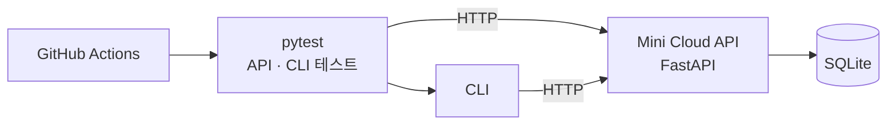

# Mini Cloud QA

가상 서버(VM)와 볼륨을 관리하는 간단한 IaaS 형태의 API를 구현하고, 명세 검토부터 테스트 설계, 테스트 자동화, CI 구성, 발견 사항 기록까지 수행한 프로젝트입니다.
실제 VM이나 스토리지는 만들지 않고, 리소스의 상태 변화와 처리 시간만 모사합니다.

## 프로젝트 개요



| 구분 | 내용 |
|---|---|
| 검증 대상 | VM 생성·시작·중지·삭제, 볼륨 생성·연결·해제·삭제 API와 CLI |
| 검증 방식 | 서비스 코드를 직접 호출하지 않고 HTTP 요청으로만 확인하는 시스템 테스트 |
| 기술 스택 | Python 3.12, FastAPI, SQLAlchemy, SQLite, Typer, pytest, GitHub Actions |

## 수행한 작업

| 단계 | 내용 | 문서 |
|---|---|---|
| 명세 작성·검토 | VM·볼륨 상태와 입력값 규칙을 정의하고, 모호한 부분을 설계 결정 13건으로 확정 | [서비스 명세](docs/spec.md), [설계 결정](docs/design-decisions.md) |
| 테스트 설계 | 상태 전이, 경계값 분석, 동등 분할, 결정 테이블 기법으로 케이스 설계 | [테스트 설계](docs/test-design.md) |
| 수동 테스트 | API 문서 화면(`/docs`)과 CLI로 설계 표를 따라 직접 확인 | [발견 사항](docs/findings.md) |
| 테스트 자동화 | 설계 표의 각 행을 pytest 테스트로 작성 (API·CLI 132개) | [테스트 설계](docs/test-design.md#테스트-코드-위치) |
| CI 구성 | PR과 `main` 푸시마다 서버를 띄워 전체 테스트 실행 | [`ci.yml`](.github/workflows/ci.yml) |

## 결과

**자동 테스트:** 132개 중 131개 통과, 1개는 알려진 결함(F-004)으로 `XFAIL` 처리 (GitHub Actions, 약 2분)

**CI 동작 확인:** 설계 결정 10에 해당하는 코드를 주석 처리한 변경을 PR로 올렸을 때, CI가 `2 failed`로 실패하는 것을 확인하고 병합하지 않았습니다.

**발견 사항 7건**

| ID | 내용 | 종류 | 상태 |
|---|---|---|---|
| F-001 | 이름 형식 오류 메시지에 정규식이 그대로 노출됨 | 개선 제안 | 열림 |
| F-002 | 같은 상태로의 시작·중지 결과가 설계 원칙과 충돌 | 명세 모호 | 해결 (설계 결정 10) |
| F-003 | 상태 변경 응답만으로 실제 변경 여부를 알 수 없음 | 개선 제안 | 해결 (설계 결정 11) |
| F-004 | SQLite에서 삭제된 id가 재사용되어, 삭제 재시도가 다른 VM을 삭제할 수 있음 | 결함 | 열림 |
| F-005 | 삭제 중인 VM에 다른 옵션으로 재요청하면 성공 응답과 함께 옵션이 무시됨 | 명세 모호 | 해결 (설계 결정 13) |
| F-006 | VM 테이블에 `delete_volumes` 칸이 누락되어 볼륨 정리 실패, 재삭제 시 500 | 결함 | 해결 (회귀 테스트 추가) |
| F-007 | VM 조회 결과에 연결된 볼륨이 보이지 않음 | 개선 제안 | 열림 |

재현 절차와 판단 근거는 [docs/findings.md](docs/findings.md)에 있습니다.

## 결론과 남은 과제

- 명세의 상태 전이표, 입력값 규칙, 결정 테이블에 정의한 동작은 자동 테스트로 확인했습니다.
- F-004는 SQLite의 id 재사용 방식에서 생기는 문제로, 운영 DB를 PostgreSQL로 한정하는 것을 전제로 두었습니다. PostgreSQL 환경에서의 검증은 아직 진행하지 않았습니다.
- 다음 항목은 명세가 확정되지 않아 테스트하지 않았습니다: 같은 이름의 VM 생성, 정의되지 않은 입력 항목, 같은 리소스에 대한 동시 요청.

| 남은 과제 | 관련 |
|---|---|
| Docker Compose로 PostgreSQL 환경을 구성해 전체 테스트 재실행 | F-004 |
| 미확정 명세 3건 결정 후 테스트 추가 | [설계 결정](docs/design-decisions.md#구현-중-발견한-명세-모호점-결정-필요) |
| 개선 제안 반영 여부 결정 | F-001, F-007 |

## 문서

| 문서 | 내용 |
|---|---|
| [서비스 명세](docs/spec.md) | 상태 전이표, 입력값 규칙, 결정 테이블, API 목록 |
| [설계 원칙과 설계 결정](docs/design-decisions.md) | 명세의 모호한 부분을 확정한 근거 13건 |
| [테스트 설계와 자동화](docs/test-design.md) | 경계값·동등 분할 표, 테스트 코드 위치, CI 구성 |
| [발견 사항](docs/findings.md) | 결함, 명세 모호, 개선 제안 7건 |
| [실행 방법](docs/how-to-run.md) | 설치, 서버 실행, 테스트 실행, CLI 사용 |

## 레포 구조

```
mini-cloud-qa/
├── service/                    # API, CLI, 자동 상태 전환
├── tests/
│   ├── api/                    # API 테스트
│   └── cli/                    # CLI 테스트
├── docs/                       # 명세, 설계 결정, 테스트 설계, 발견 사항
├── .github/workflows/ci.yml    # CI
└── pyproject.toml
```
