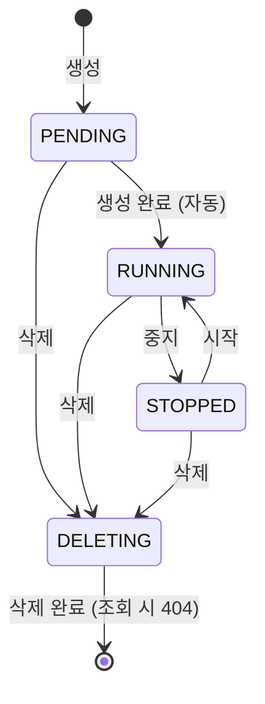

# 서비스 명세

Mini Cloud API의 상태, 입력값 규칙, API 목록입니다. 테스트 케이스는 이 문서의 표를 기준으로 설계했습니다.
본문의 "설계 원칙", "설계 결정" 번호는 [설계 원칙과 설계 결정](design-decisions.md)을 가리킵니다.

## VM 상태



| 상태 | 의미 |
|---|---|
| `PENDING` | 생성 중 |
| `RUNNING` | 실행 중 |
| `STOPPED` | 중지됨 |
| `DELETING` | 삭제 진행 중 |
| (사라짐) | 삭제 완료. 더 이상 조회되지 않음 |

## 상태 전이표

현재 상태에서 각 동작을 요청했을 때의 기대 결과입니다. 이 표의 각 칸이 상태 전이 테스트 케이스가 됩니다.

| 현재 상태 | 시작 | 중지 | 삭제 |
|---|---|---|---|
| `PENDING` | 409 | 409 | → `DELETING` |
| `RUNNING` | 200 (`RUNNING` 유지) | → `STOPPED` | → `DELETING` |
| `STOPPED` | → `RUNNING` | 200 (`STOPPED` 유지) | → `DELETING` |
| `DELETING` | 409 | 409 | 202 (`DELETING` 유지) |
| (사라짐) | 404 | 404 | 404 |

- **409 Conflict:** VM은 존재하지만 현재 상태에서 허용되지 않는 동작
- **404 Not Found:** VM이 존재하지 않음
- **202 Accepted:** 요청을 받아들였고 작업이 진행 중
- **200 (상태 유지):** 요청한 상태가 이미 이루어져 있어 아무것도 바꾸지 않고 현재 상태를 반환 (설계 원칙 2, 설계 결정 10)

시작·중지·삭제 응답에는 요청 직전 상태인 `previous_status`가 함께 담깁니다 (설계 결정 11). `previous_status`와 `status`가 같으면 원래 그 상태였다는 뜻입니다.

```json
{"id": 1, "name": "web-1", "cpu": 2, "memory_gb": 4, "status": "RUNNING", "previous_status": "RUNNING"}
```

## 입력값 규칙

| 항목 | 규칙 |
|---|---|
| 이름 | 1~63자, 영문 소문자·숫자·하이픈만 허용, 하이픈으로 시작하거나 끝날 수 없음 |
| CPU | 1, 2, 4, 8 중 하나 |
| 메모리(GB) | 1~64 사이의 정수 |
| 볼륨 크기(GB) | 1~1024 사이의 정수 |

- 숫자 항목은 **JSON 정수 타입만** 허용합니다. 문자열(`"4"`), 소수 형태(`4.0`), 참·거짓(`true`)은 자동 변환하지 않고 거부합니다.
- 입력값이 규칙에 맞지 않으면 **422 Unprocessable Entity**를 반환합니다. (상태 때문에 거부되는 409와 구분)

## 볼륨

볼륨은 VM에 연결하는 추가 디스크입니다.

| 상태 | 의미 |
|---|---|
| `AVAILABLE` | 어떤 VM에도 연결되지 않음 |
| `IN_USE` | VM에 연결됨 |
| `DELETING` | 삭제 진행 중 |
| (사라짐) | 삭제 완료. 더 이상 조회되지 않음 |

- 볼륨 하나는 VM 하나에만 연결할 수 있습니다.
- VM 하나에는 여러 볼륨을 연결할 수 있습니다.
- 연결과 해제는 VM이 `STOPPED` 상태일 때만 가능합니다. 그 외 상태의 VM이면 409를 반환합니다.

## 볼륨 상태 전이표

연결·해제는 대상 VM이 `STOPPED` 상태라고 가정한 결과입니다. 단, `IN_USE` 볼륨을 이미 연결된 같은 VM에 다시 연결하는 경우는 VM 상태와 상관없이 200입니다 (설계 결정 12).
연결·해제·삭제 응답에도 VM과 같은 방식으로 `previous_status`가 담깁니다 (설계 결정 12).

| 볼륨 상태 | 연결 (같은 VM) | 연결 (다른 VM) | 해제 | 삭제 |
|---|---|---|---|---|
| `AVAILABLE` | → `IN_USE` | → `IN_USE` | 200 (이미 해제됨) | → `DELETING` |
| `IN_USE` | 200 (이미 연결됨) | 409 | → `AVAILABLE` | 409 |
| `DELETING` | 409 | 409 | 409 | 202 (`DELETING` 유지) |
| (사라짐) | 404 | 404 | 404 | 404 |

## 볼륨이 연결된 VM의 삭제 (결정 테이블)

VM 삭제 요청에 `delete_volumes` 옵션을 줄 수 있습니다. 기본값은 `false`입니다.

| 볼륨 연결됨 | `delete_volumes` | VM 결과 | 볼륨 결과 |
|---|---|---|---|
| 아니오 | `false` | `DELETING` | 해당 없음 |
| 아니오 | `true` | `DELETING` | 해당 없음 |
| 예 | `false` | `DELETING` | 자동 해제 → `AVAILABLE` |
| 예 | `true` | `DELETING` | 함께 `DELETING` |

- 삭제 중(`DELETING`)인 VM에 대한 볼륨 해제 요청은 409를 반환합니다.
- 삭제 중인 VM에 삭제를 재요청할 때, 처음과 같은 `delete_volumes` 값이면 202, 다른 값이면 409를 반환합니다 (설계 결정 13).

## API 목록

| 메서드 | 경로 | 설명 | 성공 코드 |
|---|---|---|---|
| `POST` | `/vms` | VM 생성 (`name`, `cpu`, `memory_gb`) | 201 |
| `GET` | `/vms` | VM 목록 | 200 |
| `GET` | `/vms/{id}` | VM 조회 | 200 |
| `POST` | `/vms/{id}/start` | VM 시작 | 200 |
| `POST` | `/vms/{id}/stop` | VM 중지 | 200 |
| `DELETE` | `/vms/{id}?delete_volumes=true` | VM 삭제 (옵션 생략 시 볼륨 자동 해제) | 202 |
| `POST` | `/volumes` | 볼륨 생성 (`size_gb`) | 201 |
| `GET` | `/volumes` | 볼륨 목록 | 200 |
| `GET` | `/volumes/{id}` | 볼륨 조회 | 200 |
| `POST` | `/volumes/{id}/attach` | 볼륨 연결 (`vm_id`) | 200 |
| `POST` | `/volumes/{id}/detach` | 볼륨 해제 | 200 |
| `DELETE` | `/volumes/{id}` | 볼륨 삭제 | 202 |
| `GET` | `/health` | 상태 확인 | 200 |

서비스를 실행한 뒤 `http://localhost:8000/docs`에서 API 문서를 볼 수 있습니다.

## 구현 메모

- **자동 상태 전환:** 실제 클라우드의 백그라운드 작업 대신, 요청이 들어올 때마다 "지금까지 끝났어야 하는 전환"(`PENDING` → `RUNNING`, `DELETING` → 사라짐)을 반영합니다(`service/lifecycle.py`). 단순하고 테스트에서 예측하기 쉬운 대신, 요청이 없으면 DB의 상태값은 갱신되지 않습니다.
- **전환 시간:** `PROVISION_SECONDS`, `DELETE_SECONDS` 환경 변수로 조절합니다. 기본값은 수동 확인이 편하도록 10초, 자동 테스트와 CI에서는 1초로 실행합니다.
- **볼륨 자동 해제 시점:** VM 삭제가 **완료되는 시점**에 볼륨을 해제하거나 삭제합니다. 그래서 VM이 `DELETING`인 동안 볼륨은 `IN_USE`로 남고, 이때의 해제 요청은 409가 됩니다.

## 알려진 제약

- **SQLite에서는 삭제된 VM·볼륨의 id가 재사용됩니다 (F-004).** 늦게 도착한 삭제 재시도가 새 리소스를 지울 수 있습니다. 이 서비스는 PostgreSQL을 지원 DB로 하며, SQLite는 개발용으로만 사용합니다. 관련 테스트는 `XFAIL`로 표시되어 있습니다.

---

[← README로 돌아가기](../README.md)
